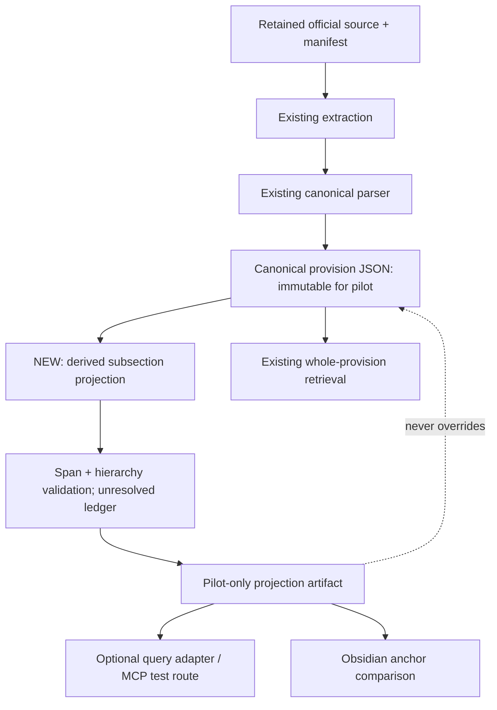

# Lex-Mex — Fintech Corpus Structural Projection Pilot

**Agent orchestration and implementation plan**  
**Date:** 2026-11-13  
**Status:** Proposed execution plan; not an implementation report  
**Repository:** Lex-Mex (confirm checkout and current branch before doing anything)  
**Pilot surface:** https://www.leg4ll4bs.com/lex-mex  
**Mandate:** Preserve the canonical fidelity-first parser while proving deterministic, source-backed retrieval of article → fracción → inciso on a bounded financial-law corpus.

> **Orchestrator directive.** Read the repository's `AGENTS.md`, `CODEX.md`, current project-state/active-run capsule, and the two audit inputs before assigning tasks. Inspect actual source, schema, tests, release artifacts and deployment wiring. Treat this document as a plan and hypothesis inventory, **not** proof of current functionality. Do not take over another agent's active ingestion task or modify its worktree. No canonical-corpus adoption or public deployment without operator approval.

## 0. Baseline and evidence

### Evidence available to this plan

1. `parser-overview-for-independent-review-2026-11-13.md` (overview at commit `6bf0f9615`).
2. `LEX_MEX_PARSER_SYSTEM_INDEPENDENT_AUDIT_2026-11-13_CODEX.md` (independent review at `c8495f7b864174eb2be760e6891ab9594840acf1`). Inspect any newer changes rather than assuming the reported HEAD remains current.
3. Public Lex-Mex landing page, which calls the site a **partial** financial/legal collection and offers Markdown, exact text, manifest and source references: https://www.leg4ll4bs.com/lex-mex
4. Public agent entrypoint: https://www.leg4ll4bs.com/lex-mex/llms.txt. At inspection it identified release `3c04016651e2fd4169632756e96ec19136136e1f42c4ed666070f23f20b30660` and linked a release-specific index and manifest. **Recheck this value at execution; pin the baseline actually inspected.** The public page/entrypoint does not promise full coverage, upstream-monitoring freshness, or historical validity.

**External-check limitation:** The landing page and `llms.txt` were accessible to the author; the release-specific `index.md` and `manifest.json` were **not independently retrievable through the browsing interface**. Agents must fetch/inspect these themselves or use the corresponding verified local build artifacts. Never assume the exact published instrument inventory from the name “Fintech collection.” Record discrepancies between the live release and local files; do not invent membership.

### Verified architecture and defects from the independent audit

- Canonical Rust `lex-core::Provision` is machine-readable at instrument/provision level (ID, type, number, heading context, text, metadata), but there is no general persistent paragraph/fracción/inciso tree.
- Definitions have specialized locator/span structure; `StandardClause` has a separate span-backed representation. Do not replace either without need.
- SQLite, public HTTP / Model Context Protocol (MCP) and Obsidian consume different representations; HTTP/MCP primarily retrieves whole provisions.
- `VI.-` can be recognized during normalization while export anchor recognition fails; a real rule-drift defect.
- `353-Ñ` is in canonical LFT material but excluded by a public SQLite reader's ASCII-only `SERVABLE` constraint; evaluate route/ID safety independently of the pilot's membership.
- Suppressed LGIPE article boundaries and an orphan CNBV amendment marker show fidelity is not the same as complete structural accounting.
- `verify-fidelity` aligns emitted provisions against extracted source; it does not exhaustively classify every source segment.
- The audit ran 323 parser/grammar/analysis tests, but **not** end-to-end deployment/release tests. Concurrent modifications were observed in fidelity-related files: do not equate that test run with a frozen immutable checkout.

**Required correction to any prior assumption:** The parser is **not** merely copying text to JSON. The experimental gap is *generalized, shared, deterministic subsection structure and retrieval* while retaining the canonical source verbatim.

## 1. Outcome and non-goals

### Primary acceptance demonstration

Given a selected, **actually published** pilot instrument, the system can resolve a user/agent request equivalent to:

> “Give me [instrument], Article N, fracción II, inciso b); return the exact text, structural path, current release ID, canonical provision ID, and source provenance; distinguish an unresolved structure from a nonexistent subsection.”

The service must return the subsection deterministically **without an LLM rereading and reparsing the full article**. The unchanged whole-article retrieval must remain available.

### Secondary outcomes

- All consumers use equivalent, tested boundary semantics (or derive from the same structural projection).
- No source wording, canonical provision ID, temporal/review decision, or approval changes without explicit separate authorization.
- Unclear attachment/parenthood is represented as *unresolved*, not silently guessed.
- Every pilot source block and every projected span is either accounted for or explicitly flagged for adjudication.
- The pilot yields a measurable go/no-go decision for expansion, rather than automatically triggering a corpus-wide migration.

### Out of scope

- A full canonical legal Abstract Syntax Tree (AST) migration.
- Machine interpretation of obligations, prohibitions, exceptions, litigation workflows or legal validity.
- Automatic historical as-of reconstruction or legal-status certification.
- Wholesale re-ingestion of all federal laws; redesigning database/search engines.
- Rebuilding the website UI before a verified retrieval contract exists.
- Expanding general Spanish regex patterns solely to pass a few hand-picked examples without negative controls.
- Adopting held LIEPS or LGIPE reparses as part of this Fintech pilot unless separately approved.

## 2. Proposed architecture



Prefer a **small reusable Rust structural scanner** in the existing grammar/parse architecture, but choose the exact crate only after examining dependency direction and existing helpers. Do not make `lex-core::Provision` acquire children in the first experiment. The structure must remain derived, optional, rebuildable, and bound to the canonical provision's text hash and projection version.

### Candidate internal record (illustrative, **not** preapproved schema)

```json
{
  "instrument_id": "<canonical instrument ID>",
  "provision_id": "<canonical provision ID>",
  "node_kind": "fraction",
  "label": "II",
  "parent_node_id": "<article or structural parent>",
  "ordinal_in_parent": 2,
  "start_char": 123,
  "end_char": 245,
  "scope": "statute_body",
  "parenthood_status": "resolved",
  "canonical_text_sha256": "<hash>",
  "projection_schema_version": "pilot-v1"
}
```

- Offset convention: **half-open Unicode scalar-value (Rust `char`) offsets** into the unchanged `Provision.text`, matching existing corpus conventions; never confuse these with UTF-8 bytes or user-visible grapheme clusters.
- Text is recoverable by source span; do **not** duplicate or paraphrase source wording as a second authority.
- Define node types and allowed structural relationships based on real samples (`article`, `paragraph`, `fraction`, `inciso`, and perhaps other nested units only when observed). Do not assume every article follows one universal tree grammar.
- Parent and child spans may nest; **siblings** must not have unexamined overlap. Preserve source order and explicit gaps/ambiguous attachment.
- A marker is not enough: avoid treating an inline citation, example, quoted decree, or list item as a live provision subsection.
- IDs must distinguish repeated labels and be deterministic for one pinned input and projection version. Hash/version-scoped derived IDs need not pretend to be stable across substantive amendments.
- Keep separate legal scopes: consolidated statute body, original transitories, reform appendix, enacting decree, substantive annex, CNBV compilation. Opaque contexts stay opaque unless specifically modeled.
- Resolve missing/ambiguous nodes with **typed error/status**, not a substitute whole article presented as though it were an exact inciso.

## 3. Pilot inventory and gold set (mandatory before implementation)

### Selection procedure

1. Pin the public `llms.txt` release; inspect its linked manifest and index (or prove why inaccessible). Verify release integrity/path and actual instrument list. Record retrieval time, URL, content hashes, local build commit and deployment mapping.
2. Cross-check the release list against local `corpus/`, adapters, `lex-db`, reader and export configurations. **Distinguish what is canonical locally from what is actually deployed.**
3. Select only a few *verified members* of the public financial-law collection. Candidate strata to check—not assumed live members:
   - `lritf` (Ley para Regular las Instituciones de Tecnología Financiera) for ordinary articles, enumerations, defined terms and existing byte-identity fixture;
   - `itf-dcg-2018` for CNBV compilation margin markers, legend and tricky article shapes;
   - `ifpe-dcg-2021` for its distinct chapter-context parser;
   - at most one additional **published** instrument if needed to cover a structural pattern absent above.
4. Within each selected instrument, choose ~5–10 representative articles or clauses, including at least one negative/ambiguous case; total pilot target ~20–30 provisions, adjusted to actual coverage. Include plain prose, multi-fraction article, nested inciso, `VI.-`, repeated labels, unnumbered closing paragraph, definition with an existing span, and a CNBV mark where present.
5. Annotate a **human-reviewed gold file**: exact expected kind/label/path, source spans, permissible ambiguity, and provenance. A legal expert must approve **legal significance**, but agents may establish mechanical boundaries from source evidence when unambiguous. Never silently create gold data by simply copying the candidate parser's output.

**Scope gate G0:** Orchestrator publishes `pilot-inventory.md`, `baseline-manifest.json`, `gold-set.json` (or equivalent), sample-selection rationale, and current working-tree isolation plan. If live manifest cannot be verified, use a clearly labeled *local release-equivalent* baseline and do not claim deployed parity.

## 4. Agents, ownership, and coordination

| Agent | Responsibility | Allowed writes | Expected artifact |
|---|---|---|---|
| **Coordinator** | Own scope, worktree isolation, task dependencies, checkpoints, merges, operator gates | Plan/decision/handoff docs only | `pilot-status.md`, go/no-go checklist |
| **A — Inventory & release** | Verify live release, local corpus inventory, source/manifest provenance and gold sample | Pilot fixtures/docs | Baseline inventory + annotated cases |
| **B — Grammar & spans** | Study scanner, fraction/inciso rules, design and implement smallest **derived projection** after G1 | Limited Rust modules + own tests | Projection library and fixtures |
| **C — Retrieval & export** | Inventory SQLite/MCP/HTTP/Obsidian interfaces; design adapter, then implement only after schema freeze | Reader/export modules and integration tests | Query/anchor parity demo |
| **D — Integrity & adversarial QA** | Negative tests, completeness ledger, Unicode, source-fidelity invariants, parser/export drift | Independent tests/evidence; no canonical corpus rewrites | Validation evidence and failure matrix |
| **E — Independent reviewer** | Challenge schema, compare implementation against audits and gold; risk/legal-scope check | Review report only | Independent acceptance/rejection |

### Orchestration contract

- All agents first perform **read-only discovery** in parallel. Freeze the G0 sample and interface contract before changing shared code.
- **One writer per overlapping file or module.** Assign separate worktrees/branches; do not parallel-edit `diputados.rs`, `lex-core`, `lex-export` or reader routes without ownership and merge order.
- Implementation tasks depend on explicit interface agreement: A/G0 → B/structural contract → C/public-consumer integration. D may build tests in parallel against frozen examples. E reviews a fixed merged candidate.
- The coordinator records commits, base HEAD, test commands/outcomes, source fixture hashes and all unresolved decisions at every gate. Existing active ingestion capsule/run must not be overwritten.
- If an agent discovers a legal ambiguity, document exact source/offsets, alternatives, likely downstream consequences and request a targeted operator decision. Do not send every punctuation issue for legal sign-off.
- Do not silently import library/framework dependencies. First assess existing Rust crate capabilities; keep the implementation lean and local to the repo.

## 5. Work packages and sequence

### Phase 0 — Inspect and freeze baseline (read-only)

**Owner:** Coordinator + A + D. **Before code changes.**

- Confirm repository rules, branch/HEAD, uncommitted work and concurrent active tasks.
- Pin published/local release and prove selected instrument membership.
- Trace `Provision`, `DefinedTerm`, `StandardClause`, `normalized_blocks`, `is_fraction_start`, `paragraph_anchors`, `run_parse`, SQLite schema, `query-sqlite.mjs`, `query-http.mjs`, and `mcp-tools.mjs`.
- Capture actual canonical JSON, actual published Markdown and an actual MCP/HTTP response (or label inaccessible) for the same gold article.
- Snapshot existing behavior of `VI.-`, a nested inciso and a CNBV marker; capture URLs/paths, without making destructive requests.
- Produce an explicit matrix of behavior: canonical parse / derived link / DB index / Obsidian / HTTP / MCP / published website.

**Exit G0:** Reproducible baseline with no inferred membership or unverified endpoints; gold set signed off for structural accuracy.

### Phase 1 — Fix minimal demonstrable parity defects (small PRs)

**Owner:** B for shared recognition, C for consumer adaptations, D for regressions. **Do not broaden scope.**

- Repair `VI.-` recognition in export using shared semantics or a minimal proven parity fix. Test `VI.-`, `VI. `, `VI.`, `VI Bis.-`, inline references, repeats and false positives using actual source examples.
- Ensure links refer **only to anchors actually emitted**. Avoid duplicate IDs.
- Audit public route/ID encoding and canonical ID coverage with `N` vs `Ñ` as an independent regression, even if LFT is not in the public pilot. Choose a Unicode-safe route/alias strategy without collisions, not an ASCII-only workaround that hides provisions.
- Explicitly account for CNBV orphan marks: preserve linked/provenance evidence or fail/hold; never silently discard an unaccounted marker. Limit implementation to observed cases and source evidence.
- Keep LGIPE suppressed-article segmentation and held LIEPS temporal grouping as separately tracked backlog items unless they block pilot evidence; do not smuggle their re-ingestion into this feature.

**Exit G1:** Consumer boundary recognition matches agreed test cases; old tests still pass; no canonical output changes; unresolved marker behavior is visible and tested.

### Phase 2 — Derived span/tree projection (pilot-only)

**Owner:** B, reviewed by D. **Begin only after G0 and interface agreement.**

- Construct a deterministic scanner over a canonical `Provision.text` string (and minimal explicit source-family configuration where needed). Reuse label grammar and established glossary spans instead of independently reinventing Roman-number rules.
- Emit article-relative nodes for resolved paragraphs/fracciones/incisos and explicit **unresolved** segments/parenthood. Preserve article-level text if structural segmentation is unsafe.
- Bind every projection to `provision_id`, exact canonical text hash, projection algorithm/schema version and source release.
- Add local artifacts under a **scratch/pilot** path, not `corpus/` or production release directories. Favor simple JSON files first; evaluate database materialization only if lookup tests justify it.
- Validate exact Unicode substring recovery, inclusive/exclusive boundary consistency, sibling overlap/order, containment, repeated numbering, gap accounting and deterministic reruns.
- Make invalidation/rebuild mandatory after canonical text hash or projection-version change. No transfer of reviewed decisions merely because normalized words appear equal.

**Exit G2:** Every reviewed gold node resolves to the exact approved source span/path; all intentional ambiguity is explicit; running twice on identical inputs yields byte-identical projection; **zero canonical corpus diffs**.

### Phase 3 — Retrieval contract and demonstration (feature-gated)

**Owner:** C, with B interface support and D adversarial tests.

- Define a versioned, opt-in operation such as `get_subsection` (name illustrative) with `release_id`, canonical instrument/provision identity and a typed structural path. Do **not** invent a public URL convention before inspecting the existing router and MCP contracts.
- Return exact canonical substring; locator/path; parent article; start/end char; text hash and projection version; provenance pointer; and one of `resolved`, `ambiguous`, `not_structured`, `not_found`, `stale_projection`, etc. Define typed meanings so that failure is not presented as success.
- Retain current `get_provision` contract unchanged. A typed `ambiguous` must not silently fall back to an asserted exact inciso.
- If an HTTP/MCP consumer cannot represent this safely, implement only a local CLI/query test harness and document the deferred route. **Do not force deployment for pilot completion.**
- Compare queries against the published Markdown/Obsidian anchors and existing specialized glossary spans. Prove they recover the **same** relevant text at their respective scopes.
- Build a minimal human-verifiable demonstration using a few real gold examples (at least one nested inciso, one Roman `VI.-`, one ambiguous or unsupported structure).

**Exit G3:** End-to-end pilot calls are deterministic, support exact provenance, preserve old interfaces, and correctly distinguish missing from ambiguous.

### Phase 4 — Completeness/integrity ledger and independent review

**Owner:** D + E; coordinator integrates.

- Pilot a **source-block disposition ledger** for the selected sources. For each source block, classify: preserved in provision, structural heading, document furniture, decree wrapper, annex, out-of-scope supplement, or unresolved; record reasons and source offsets where obtainable.
- Measure separately: (1) output-to-source fidelity; (2) source-to-output accounting; (3) node-boundary precision/recall on manually reviewed gold; (4) public retrieval/route coverage; (5) unresolved rate; (6) latency and artifact size relative to whole article retrieval.
- Do not infer complete PDF page fidelity from a normalized extracted-text span. Verify official-text and extracted-text layers separately.
- Independently audit Unicode offset roundtrips across Rust and JavaScript, including accented characters, `Ñ`, composed/decomposed text and supplementary Unicode characters.
- Independently replay the full **selected pilot only** in scratch; diff canonical IDs, text, metadata, approvals, timestamps where applicable, parser logs, exports, and public responses.
- Have E verify tests *actually executed*, not merely tests present, and inspect dirty-worktree changes at review time.

**Exit G4:** Independent review reports empirical results, regressions and blockers; operator receives a reasoned **adopt / iterate / abandon** recommendation.

## 6. Quantitative acceptance matrix

| Measure | Pilot requirement | Evidence |
|---|---|---|
| Canonical record preservation | **Zero unauthorized changes** to canonical text, IDs, temporal status, approvals or source manifest | Git/hash diff against frozen baseline |
| Gold structural accuracy | **100% exact match on manually approved gold cases** for resolved spans/path; ambiguous gold cases reported as ambiguous | Gold fixture comparison |
| Text fidelity | Every resolved node reconstructs the **exact** canonical substring using Unicode char offsets | Property tests + sampled source comparison |
| Silence/coverage | **Zero silently unaccounted pilot source blocks**; explicit unresolved dispositions allowed and counted | Block ledger |
| Determinism | Byte-identical projection and query results for same source/release/version | Repeat-run hash comparison |
| Export consistency | No missing/duplicate anchors on pilot-supported examples, including `VI.-` | Markdown golden + link checks |
| Retrieval semantics | Exact subsection available when resolved; typed unresolved/absent response otherwise; existing whole-provision API unchanged | HTTP/MCP or local harness contract tests |
| Unicode identity | N and Ñ remain distinct and retrievable where eligible; no collision or malformed route | Regression across parser/reader |
| Regression suite | Affected Rust/export/reader tests pass; no failing preexisting test masked or rewritten | Logged commands, exit codes, diff |
| Release compatibility | No public release changed without gate and operator approval | Pinned release comparison |

**Avoid a misleading aggregate accuracy score.** Report denominators by instrument, node kind, supported shape, unresolved shape and negative control. If the gold set is too small or skewed, expand it *within the bounded corpus* before recommending expansion.

## 7. Failure handling and decision rights

- **P0 / stop:** canonical data or reviewer decisions altered unexpectedly; source evidence lost; projection falsely labeled as exact when ambiguous; unsafe public route causing ID collision; unchecked corruption of source spans.
- **P1 / fix before any deployment:** `VI.-` anchor drift, observed public-ID exclusion, orphan mark with no explicit accounting, wrong parent-child attachment in an accepted gold case, implicit fallback from exact subsection to whole article.
- **May remain explicitly unresolved in pilot:** deeply nested or anomalous drafting, transitory amendment semantics, ambiguous final paragraph, unmodeled annex table structures, source layouts that cannot be justified mechanically.
- **JRH/operator decision required:** whether a suppressed/invalidated provision is legally effective; temporal application; disputed legal categorization; adoption into canonical corpus; production release/deployment; material public API compatibility tradeoff.
- **Agents decide without legal escalation:** extraction boundary supported by source; implementation/module choice; negative cases, performance measurements, fixture mechanics, read-only investigation.

## 8. Required outputs and handoff format

Create under a new isolated planning/report folder (choose repository-conventional location after inspection):

1. `00-baseline-and-live-inventory.md` — verified published release + actual member instruments, current checkout, provenance and access gaps.
2. `01-gold-casebook.md` + machine-readable fixtures — selected provisions, expected hierarchy and offset definitions, negative/ambiguous cases.
3. `02-contract-and-design.md` — typed projection schema, parent/child rules, state transitions, version/hash strategy, interface compatibility.
4. `03-implementation-and-diffs.md` — ownership, file-level change log, scratch artifacts, commands and outcomes.
5. `04-validation-matrix.md` — fidelity vs completeness, gold comparison, Unicode, links/reader, negative controls, performance.
6. `05-independent-review.md` — code/artifact evidence, counterexamples, residual risks, whether findings from the Astra audit were actually addressed.
7. `06-decision-record.md` — adopt/iterate/abandon recommendation, exact allowed next slice, required operator sign-offs.

**Agent handoff template (all agents):**

```text
Task / owner / worktree / base commit:
Inputs inspected (paths + hashes):
Facts verified (file path, symbol, representative real output):
Hypotheses or unknowns:
Changes made (files, commit; none for read-only work):
Tests executed (exact commands, exit codes):
Canonical/source/reviewer diffs:
Risks / blocked cases:
Next agent input required:
```

## 9. First orchestration message to dispatch

> **Coordinator: initiate Lex-Mex Fintech Structural Projection Pilot, starting at Phase 0 only.** Read AGENTS/CODEX and discover current active agent work; preserve it. Assign independent read-only agents to (A) verify current published `lex-mex/llms.txt` release, manifest, published index and actual Fintech instruments; (B) trace exact parser/tree/span contracts in Rust and the canonical JSON; (C) trace SQLite/HTTP/MCP/Obsidian consumers and anchor/ID mismatches; (D) propose 20–30 representative gold/negative cases and source-block accounting. Return a consolidated baseline, actual gold candidates, conflict-free worktree plan and proposed smallest design contract. **Do not start implementation or modify `corpus/`, reviewer approvals, release artifacts or production deployment until G0 is accepted.** Then orchestrate Phases 1–4 using the gates, per-file ownership and independent review in this plan. Preserve all source text and explain any ambiguity instead of guessing.

## 10. Final strategic constraint

**Lex-Mex is a legal corpus first, a retrieval system second, and a legal-reasoning engine later.** The pilot succeeds if it enables reliable, exact, traceable subsection access **without undermining the existing fidelity-first architecture**. Do not mistake structural machine-readability for substantive legal interpretation, and do not mistake a successful local demonstration for a validated public release.
