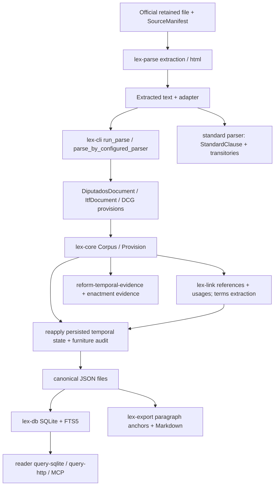

# Lex-Mex Parser: Fidelity, Structure, and System Integration — Independent Audit

Date: 2026-11-13. Reviewer: Codex. Investigation only; no implementation or corpus adoption.

## 1. Executive verdict

**Verified:** Lex-Mex produces machine-readable legal structure at instrument and provision level, with structured heading context, temporal/review metadata, citation edges and qualifiers, and defined-term spans. It is more than text wrapped in JSON. It does **not** expose a general canonical hierarchy of paragraphs, fracciones and incisos in `Provision`. Most internal article structure remains prose; specialized glossary extraction preserves some fraction/inciso locators and Unicode character spans. Standards have their own span-backed clause representation.

Downstream SQLite stores provisions and relations with foreign keys and FTS5. Public HTTP/MCP retrieval addresses provisions, not arbitrary subsection paths. Obsidian derives paragraph anchors from text and glossary spans. Thus structural understanding is distributed, and the parser and exporter have demonstrably different fraction recognition rules.

The core fidelity-first architecture is appropriate. A bounded derived structural projection is a plausible improvement, not justification for replacing canonical records with a full legal AST. First repair concrete consumer inconsistencies and measure coverage on a small sample.

Verified limitations include export failure to recognize `VI.-` as a fraction anchor, retained LGIPE suppressed headings inside another article, and a test explicitly accepting an orphaned CNBV amendment marker without a provision attachment. Historical legal reconstruction and general obligation/exception reasoning are not established by these structures. This is a code/artifact audit, not a legal status determination or certification of the entire corpus.

## 2. Scope and evidence

Authorized scope: `prompts/LEX_MEX_PARSER_SYSTEM_AUDIT_FOR_CODEX.md`, SHA-256 `a0faced910677d94d41f39e7722180a2bc5b20e5171de2c8028b1e24e2cc157d`. Operator explicitly authorized inspection and saving this report in `prompts/`.

Checkout: `upgrade/four-goal-2026-11-12`, HEAD `c8495f7b864174eb2be760e6891ab9594840acf1`, later than overview baseline `6bf0f9615`. Initial dirty state: only the untracked audit prompt. Cargo 1.95.0; rustc 1.95.0. Root AGENTS/CODEX read; repository registered as `lex-mex`. Existing active-run capsule discovered, checkpoint 225 at discovery; its ingestion task was not taken over.

Sources: actual Rust types, parser/export/fidelity implementations, SQLite schema, HTTP/MCP/SQLite reader code, selected corpus records and manifests, existing parser fixtures; overview, parser-rule inventory, held-source contracts, difficulty log, decisions and four-goal plan as claim inventories. Symbols below are stable navigation references; line numbers refer to this checkout.

Evidence vocabulary: **Verified** means directly inspected code or artifact; **Documented only** means a repository claim not independently reproduced; **Inferred** means architectural consequence; **Unverified** means not established here. Runtime test results are recorded in section 10. No network, canonical parse, full-corpus reparse, or legal review mutation was performed. Source PDF visual/layout fidelity was not independently inspected. This report does not claim exhaustive auditing of every offset conversion or parser branch.

## 3. Actual end-to-end architecture



| Stage | Input → output | Authority | Source location | Invariant/evidence |
|---|---|---|---|---|
| Acquisition/extraction | official file → text/manifest | retained evidence | `lex-parse/src/extraction.rs`, `html.rs`; source manifest | extracted hash and tool version persisted |
| Dispatch | adapter/text → family document | deterministic canonicalization | `lex-cli/src/main.rs::run_parse`, `parse_by_configured_parser` | adapter family selects parser |
| Statute segmentation | logical blocks → provisions | canonical | `diputados.rs::parse_diputados_publication` | stateful headings/transitories/enactment partition |
| CNBV | compiled text → provisions/marks/legend | canonical evidence | `itf.rs::parse_itf_dcg`, `dcg.rs::parse_dcg` | orphan fixture exposes exception |
| Link/glossary | provisions → edges, terms, usages | derived facts with review constraints | `lex-link/src/references.rs`, `usages.rs`; `terms.rs` | source spans and target validation required |
| Persistence | Corpus → JSON | committed corpus | `main.rs::run_parse` calls `write_canonical` after guards | prior temporal state reapplied before writes |
| Database | JSON → relational projection | derivative | `lex-db/schema.sql` | foreign keys, input paths/pointers, JSON extras |
| Retrieval | pinned release → public DTO | restricted projection | `reader/query-sqlite.mjs`, `query-http.mjs`, `mcp-tools.mjs` | release ID required; whole provision |
| Export | prose + terms/edges → Markdown | presentation | `lex-export/src/lib.rs::paragraph_anchors` | duplicate anchors suppressed |

Counts measured by filesystem/adapter metadata only: 468 `provisions.json` files; 458 Diputados and 9 ITF adapters, one IFPE adapter, five JSON adapter files without a `parser` value. These are not counts of legally current instruments or benchmark measurements.

## 4. Data-model findings

`lex-core/src/lib.rs::Provision` (line 921) contains schema/id/instrument/type/label/number, optional numbering basis, heading context, text, publication/effective dates and period, temporal basis/confidence/status, review status, effects, amendment marks, repeals and commencement condition. No generic children, parent provision node, paragraph order or subsection source span appears in this type. JSON arrays persist these records; optional fields may be omitted.

Real record excerpt from `corpus/mx/lritf/provisions.json`, selected by ID (only text abbreviated; this is not a complete record):

```json
{
  "schema_version": "0.1.0",
  "id": "urn:lex-mx:federal:statute:lritf:article:4",
  "instrument_id": "urn:lex-mx:federal:statute:lritf",
  "provision_type": "article",
  "label": "Artículo 4",
  "number": "4",
  "heading_context": {"title": "Título I", "chapter": null},
  "text": "Para efectos de esta Ley, en singular o plural, se entenderá por: [ABBREVIATED FOR REPORT]",
  "publication_date": "2018-03-09",
  "effective_from": "2018-03-10",
  "temporal_status": "effective",
  "review_status": "machine_accepted"
}
```

| Layer | Representation / structured fields | Prose retained | Direct queryability | Evidence |
|---|---|---|---|---|
| Instrument | identifiers, source metadata, dates | titles | public catalog/provision wrapper | `Instrument`, public DTOs |
| Article/transitory/annex | typed provision, number, heading context, temporal/review fields | body including nested lists | provision ID/route | `Provision`; MCP get_provision |
| Paragraph/fraction/inciso | no general tree; special defined-term locator/span | most nested structure | special spans locally; no general MCP locator | `DefinedTerm` lines 1267–1292 |
| Citation/term | source/target IDs, qualifiers, spans, resolution status | cited phrase/definition | references endpoint; relational terms | `ReferenceEdge`, schema tables |
| Temporal | dates/status/effects, separate reform/enactment evidence | legal conditions/rationale | recorded status returned; no as-of route verified | `Provision`, `reform.rs`, query DTO |
| Standards | numbered clause and source span, amended_by | clause body, opaque supplements | separate standards subsystem | `StandardClause` line 293 |
| Legal interpretation | some temporal effects and reviewed classifications | general substantive rule meaning | no general obligation AST verified | temporal types versus Provision |

HeadingContext holds libro/title/chapter/section/apartado strings; it is structured context, not independently addressable heading nodes. IDs encode instrument, type and normalized label. LFT `353-Ñ` persists as `...:article:353-ñ`, distinct from `353-N`. LIEPS's printed number `3o` maps to ID suffix `:3`: labels and IDs are not interchangeable. No universal renumbering-stable identity guarantee was established.

## 5. Structural parser mechanics

Verified: regex/scanner predicates plus explicit state, not a general legal AST parser. `normalized_blocks` removes recognized furniture and joins/reflows lines. `partition_enactment` / `partition_nested_instrument` precede the main loop. State includes current builder, HeadingContext, statute-transitory/roman/singleton flags, annex modes, enactment layer and seen ordinals (`diputados.rs:1656` onward).

| Trigger | Effect | Boundary limitation |
|---|---|---|
| Article label | closes prior builder, opens provision | recognition/configuration must distinguish quoted/decree headings |
| Structural heading | updates context | no addressable heading child |
| Transitory/enactment section | changes numbering/scope state | law and amending decree must remain separate |
| Substantive annex | opaque body until configured stop | not a table/cell AST |
| Fraction marker | normalization break/reflow decision | does not instantiate generic fraction node |
| Signature/document stop | closes/stops main text | intended exclusions need external coverage evidence |

Ambiguous trailing unnumbered paragraphs have no generic typed parenthood in Provision: the system retains prose rather than resolving an arbitrary hierarchy. Glossary-specific profiles solve narrower definition cases.

Independent structure detection exists in normalization (`is_fraction_start`), glossary extraction and export (`paragraph_anchors`). Parser accepts `VI.-`; export regex `^...\.\s` does not. This is verified rule drift. Adapter source-bound exceptions and reviewed profiles exist, but every exception's hash binding was not individually audited. Dedicated old-DCG parsers remain a documented proposal; this review does not establish that all four require separate implementations.

## 6. Source integrity review

| Invariant | Claim/enforcement | Evidence | Gap/consequence |
|---|---|---|---|
| Text fidelity | token alignment with classified gaps/marks | `fidelity.rs::tokenize`, `check_document`, `align` | output-to-source alignment is not exhaustive source accounting |
| Completeness | counts, fixtures, debt/furniture checks | plan and rule inventory; folded LGIPE record | counts can preserve an already incomplete segmentation |
| Provenance | URL/publisher/time/file and extracted hashes/tool versions | LRITF source-manifest; `run_parse` Instrument construction | no generic subsection-to-PDF-page map verified |
| Unicode offsets | Rust chars, half-open slices | `lex-grammar::char_slice`; DefinedTerm; export counts | not grapheme clusters; every consumer conversion not exhaustively checked |
| Approval preservation | reapply/check reconfirmation before writes | `main.rs::reconfirmed`; core reconfirmation tests | no claim that a new whitespace hash automatically authorizes transfer |
| Fail closed | some unknown structures reject | parser fixture coverage | orphan marker test contradicts unconditional no-drop language |

`tokenize` splits Unicode whitespace without changing other tokens. `check_document` iterates supplied provisions, aligns each, classifies gaps within alignments and returns per-provision results. It does not create an exhaustive disposition for every input block, including text outside those alignments. This distinction remains even if all supplied provisions pass.

Canonical text can be recovered exactly from its stored string. Original PDF layout, furniture, wrapping and complete excluded source cannot be reconstructed solely from Provision. Retained files/manifests remain essential. Span-backed definitions recover the canonical substring, not original page coordinates. Reflows change hashes/offsets; `check_reconfirmation` and occurrence-binding tests are meaningful safeguards, not a reason to loosen review guards.

## 7. Downstream consumers

| Consumer | Artifact/granularity | Deterministic lookup | Inference needed | Provenance/evidence |
|---|---|---|---|---|
| SQLite | canonical provision/edge/term records | IDs, FKs, FTS5 | generic sub-article interpretation | input_files + source_pointer + extras; schema.sql |
| Public HTTP/MCP | release-specific Article DTO | instrument/type/number | arbitrary inciso requires reading article | source URL/hash/text hash, statuses; mcp-tools |
| Obsidian | paragraph text + term spans | emitted unique block anchors | ambiguous/unanchored lists fall back | paragraph_anchors and export tests |
| Linking | references/term usages | resolved IDs and explicit spans | relation does not imply applicability | qualifiers and resolution statuses |
| Temporal analysis | status/effects/evidence/review | recorded fields | historical legal reconstruction not demonstrated | separate reform evidence and approval workflow |

SQLite uses STRICT tables, JSON-valid extras, FKs for resolved targets, reference qualifier rows, defined terms/usages and FTS5 `unicode61 remove_diacritics 2`. This is a relational citation/definition graph, not an obligation or litigation-procedure graph engine.

`get_provision` accepts release_id, instrument, type, number; unknown arguments reject. There is no fraction/inciso argument. Path is built in `callRetrievalTool`, dispatched through `handlePublicQuery` to the adapter. `Article` returns the full text, not subsection nodes. No as-of legal-date query is established; a pinned corpus release is not a reconstructed historic legal version.

Additional verified limitation: `reader/query-sqlite.mjs::SERVABLE` excludes ID suffixes containing characters outside `[a-z0-9-]`; its comments explicitly document that restriction. Consequently canonical LFT `353-ñ` is outside that adapter's servable ID set. Do not conflate parser support with public retrieval support. Live deployed release inclusion was not tested.

## 8. Case studies

1. **Nested definition, LIEPS.** Retained `.work/lieps/lieps.txt:806` begins `a) Bebidas alcohólicas`. Canonical article ID `...:lieps:article:3` has printed number `3o`. Actual `terms.json` record `...:term:bebidas-alcoholicas` stores fraction `I`, inciso `a`, start_char 165, end_char 421. A Python Unicode slice of the actual provision returned the complete `a)` definition ending with two newlines. Thus this inciso is already machine-addressable through specialized stored spans. Export uses term offset anchors; general MCP still returns the article. Full source-to-output validation was not rerun.

2. **Numbering, LFT.** Actual provisions contain both 353-N and 353-Ñ; Ñ's record ID ends `353-ñ`, heading context title SIXTH/chapter XVII, body retains I/II/III as text and an amendment note. `heading_letter_suffix` and article recognition provide parser support; public SQLite SERVABLE rejects the non-ASCII suffix. This is a concrete pipeline mismatch, not proof of missing canonical content.

3. **Boundary, LGIPE.** Actual article 80 text contains `[Artículo 80 Bis. Suprimido]` followed by amendment/invalidity notices. The plan documents twenty folded suppressed headings. Independently verified one occurrence, not all twenty. Fidelity of retained words does not guarantee a separately retrievable 80 Bis record. Classification of legal validity is distinct from preserving the printed boundary.

4. **CNBV orphan fixture.** `itf.rs::a_marker_orphaned_by_a_structural_heading_is_discarded_silently` supplies Apartado D, marker (9), `(Derogado)`, transitories and a legend. Parsing succeeds; article 25 has no amendment marks. The comment asserts redundancy, but this fixture does not prove attachment to a separate affected provision. Retained legend is not a typed heading-to-amendment relation.

5. **Temporal grouping, LIEPS — Documented only.** Four-goal plan lines 741–769 reports acuerdos grouped under preceding decrees, erroneous dating and omissions in the held reparse. No adoption or independent reproduction here. The acceptance criterion is source decree/date grouping, not legal interpretation by a model.

6. **Standards — type-level verified, artifact trace unverified.** StandardClause has standard_id, number, text, start/end characters and amended_by. Standard transitories/supplements are separate and deliberately opaque internally. No actual NOM/NMX output was sampled; do not generalize article findings to all standards.

## 9. Architecture options and recommendation

| Option | Benefit | Cost/risk | Verdict |
|---|---|---|---|
| A: retain current structure | stable corpus, no migration | generic subsection retrieval remains prose-based | adequate for whole-article use |
| B: derived span projection | deterministic navigation, shared export/query boundaries | ambiguity/coverage/versioning must be explicit | recommended bounded experiment after concrete repairs |
| C: canonical full AST | universal hierarchy if successfully modeled | high schema/reviewer/consumer migration risk; legal drafting ambiguity | not justified by evidence |

Candidate only: `{instrument_id, provision_id, node_kind, node_id, parent_id, order, label, source_span_start, source_span_end, canonical_text_hash, projection_version, scope, parenthood_status}`. Offsets: half-open Unicode scalar indices into unchanged canonical provision.text. Nodes contain no authoritative duplicated wording. IDs bind provision/hash/projection version/path; no promise of survival across substantive changes. Express implicit paragraphs and unresolved parenthood without guessing. Heading context may be referenced; distinguish consolidated-statute, enactment and reform-decree scope. Rebuild/invalidate on hash/version change, leaving source and reviewer approvals untouched.

Require exact substring recovery, bounded spans, sibling order/non-overlap where appropriate, allowed parent-child containment, deterministic output, repeated-label disambiguation and explicit unresolved regions. Source-page recovery is not promised without an extraction mapping. Compare a small real sample before scaling; no performance measurements justify a whole-corpus migration.

## 10. Validation/test findings

Static checks executed: Git branch/HEAD/status; SHA-256 of authorized prompt; Cargo/rustc versions; targeted rg/sed reads; Python selection of actual records, Unicode substring extraction, adapter-family and provision-file counts. All cited samples came from existing artifacts. One initial lookup for printed `lieps` number `3` found none; resolved by actual ID to number `3o`. `sources/` did not exist; retained text was located under `.work/`. Neither is a corpus defect.

| Test/invariant | Current evidence | Status | Residual risk / recommended check |
|---|---|---|---|
| Reversion/normalization decisions | reconfirmation test symbols inspected | static | execute exact occurrence/hash regressions |
| Fraction anchor parity | parser/export regex comparison | verified mismatch | real `VI.-` export golden |
| Orphan marks | existing ITF test inspected | explicit accepted behavior | require accounted heading evidence or fail |
| Coverage | LGIPE actual body | boundary gap verified | source-block disposition ledger pilot |
| Unicode spans | real LIEPS slice | verified sample | cross-language roundtrip property tests |
| Public IDs | Ñ record + SERVABLE | verified contract exclusion | Unicode ID endpoint test |
| Determinism/full corpus | not run | unverified | scratch diff before any adoption |

Automated test command/outcome is appended below. No production parse, re-ingest, corpus-wide fidelity run, database rebuild or export was executed. Existing test names are evidence of intended behavior, not claimed passing results unless the run below establishes that.

## 11. Prioritized findings

- **P1: generic subsection structure is not a shared contract.** Impact: agents must interpret prose; normalization/export diverge. Evidence: Provision, DefinedTerm, paragraph_anchors, MCP arguments. Reproduce with `VI.-` versus regex. Scope: export/navigation, not authoritative wording. Remedy: small parity repair, then measured derived projection. Owner: engineering agent; regression: real canonical text and anchor/link golden.
- **P1: canonical/public identifier coverage differs.** Evidence: LFT 353-ñ and SERVABLE restriction. Impact: available canonical provisions may be absent from public lookup/search. Remedy: explicit Unicode-safe route contract or documented alias mapping without collisions. Owner: engineering; regression: N versus Ñ end-to-end DTO/URL distinction. Deployed impact unverified.
- **P1: folded LGIPE heading prevents independent addressing.** Evidence: article 80 body. Remedy: bounded source-specific regression and scratch diff; preserve legal uncertainty. Owner: engineering segmentation; JRH only for substantive status. Corpus-wide count unverified here.
- **P1: orphan marker accounting is incomplete.** Evidence: named ITF fixture; no heading attachment field. Potential provenance loss, not proven wrong-law outcome. Remedy: explicit excluded/heading evidence and redundancy verification or reject. Owner: engineering; test marker with and without provable redundant attachment. No new P0 asserted without verified legal consequence.
- **P1, documented only: LIEPS reform grouping remains held.** Follow existing source-backed acceptance criterion, not a general AST rewrite. Engineering owner; regression each retained decree/date and acuerdo boundary.
- **P2: blanket fail-closed/completeness wording overstates guarantees.** Remedy: distinguish fidelity, segmentation coverage, exceptions and unavailable public records in reports. Owner: engineering/docs; test report flags reflect observed limitations.

## 12. Open questions for JRH only

No new legal question is necessary to act on this audit's engineering findings. Existing LGPP/LGIPE legal-status review remains separate. This report does not decide whether suppressed/invalidated text has legal effect.

## 13. Next implementation slice (proposal only)

Repair export recognition of parser-supported dotted-hyphen Roman fractions using existing canonical text. Acceptance: `VI.-` and `VI. ` produce the expected unique anchor; repeated numerals remain suppressed; inline/non-leading markers do not create false anchors; links use only emitted anchors; canonical files, IDs, offsets and approvals remain byte-identical. Add a real export golden and run affected checks. No implementation performed.

**Can Lex-Mex retrieve a particular fracción/inciso today without reparsing article prose? — Partly.** LIEPS I(a) has a stored, verified definition span (165..421), and unique export anchors exist for supported shapes. Arbitrary Article 15/II/b is not an MCP lookup contract; full article retrieval still requires interpretation.

**Would a derived typed subsection tree materially improve the system? — Yes, for general deterministic subsection access and shared consumer boundaries.** Keep it derived, hash-bound and ambiguity-aware. Existing specialized spans already solve some cases; a full canonical AST migration is not warranted.

### Executed automated validation

Delegated mechanical run: `CARGO_TARGET_DIR=/private/tmp/lex-mex-audit-target cargo test --offline --locked -p lex-parse -p lex-grammar -p lex-analysis`.

Exit 0: lex-analysis 30 passed; lex-grammar 17 passed; lex-parse 276 passed; zero failures; doc-tests zero tests. Total 323 passing tests. This does not validate the full CLI/export/reader pipeline or prove exhaustive corpus coverage. Build output was confined to the temporary target directory.

### Final workspace caveat

The final status check detected concurrent modifications not made by this audit: `crates/lex-cli/src/fidelity.rs`, `crates/lex-cli/src/qualifier_audit.rs`, `crates/lex-cli/src/source_monitor.rs`, `crates/lex-link/src/qualifier_audit.rs`, and `crates/lex-parse/src/fidelity.rs`. They were preserved. Therefore the test run is working-tree evidence, not a certified immutable-commit run; the independent reviewer should inspect those diffs before relying on fidelity-related conclusions at a later checkout. No commits were created. The attempted existing-capsule checkpoint was rejected by automatic approval review as outside the report-only write authorization; no continuity update is claimed.
